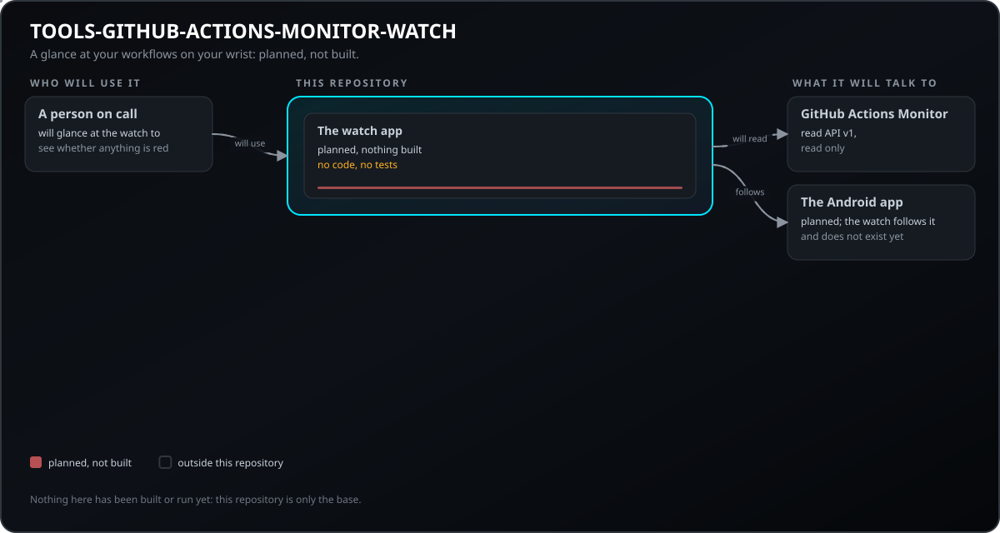

<p align="center">
  
</p>

# 🛠️ TOOLS-GITHUB-ACTIONS-MONITOR-WATCH

<p align="center">🇺🇸 <b>English</b> | <a href="README_spa.md">🇪🇸 Español</a> | <a href="README_fra.md">🇫🇷 Français</a> | <a href="README_ita.md">🇮🇹 Italiano</a> | <a href="README_deu.md">🇩🇪 Deutsch</a> | <a href="README_zho.md">🇨🇳 中文</a> | <a href="README_jpn.md">🇯🇵 日本語</a> | <a href="README_por.md">🇵🇹 Português</a></p>

### Planned minimal watch companion of the Android app of GitHub Actions Monitor: a quick look at your workflows on your wrist. Scaffolding only: nothing is implemented yet.

<p align="center">
  
  
  
  
  
  
</p>

---

**Honesty check - what actually runs today:** nothing of the watch app. This repository holds only its base: the documents, the manifest, the licence and the shared repository checks. There is no code, no package, no screen, no notification service and no test of the app, and nothing has been tried on a watch.

---

## 📋 At a glance

| | |
|---|---|
| Version | `0.0.1` |
| Maturity | Scaffolding |
| Tests | None yet (only the checks of the repository) |
| Stack | Kotlin and Wear OS (planned) |
| On real hardware | Not run on a watch |

**Jump to:** [Overview](#-overview) · [Architecture](#-architecture) · [Quick start](#-quick-start) · [Testing](#-testing) · [Repository Structure](#-repository-structure) · [Related Projects](#-related-projects)

## 🚦 Project status

Each line is one part of this repository and the light says how far it is today. It is written from what the repository can show (tests, builds, runs), not from what is planned.

🟢 Done and verified · 🟡 Works, with known limits · 🟠 Partly done or not verified yet · 🔴 Not done or not working

| Area | State | What it means here |
|---|---|---|
| Repository base | 🟡 | The manifest, the README files in eight languages, the licence and the shared repository checks run in CI. |
| Watch app code | 🔴 | Not started: there is no watch project in this repository yet. |
| Tests | 🔴 | There are no tests of the app; only the checks of the repository run. |
| Connection to the monitor | 🔴 | Not started. How the watch will get its data (through the Android app or directly) is not decided. |
| Watch and notifications | 🔴 | Not started and never run on a watch; no notification service is connected. |

## 🎯 Overview

* **What it will be:** a minimal watch version of the Android app, with a quick look at whether anything is red and at the latest important alerts of your own monitor.
* **It follows the Android app:** it is built after [TOOLS-GITHUB-ACTIONS-MONITOR-ANDROID](https://github.com/JuanenRac/TOOLS-GITHUB-ACTIONS-MONITOR-ANDROID) and keeps to a subset of what that app shows.
* **Read only:** it will only read from your monitor. It will not write to GitHub and it will not change anything in the monitor.
* **What it is not (yet):** there is no app to install, no release and no date. This repository only reserves its place and says honestly what is planned.

## 🧩 Role in EH3D

TOOLS-GITHUB-ACTIONS-MONITOR-WATCH is meant to be the minimal watch version of the Android app [TOOLS-GITHUB-ACTIONS-MONITOR-ANDROID](https://github.com/JuanenRac/TOOLS-GITHUB-ACTIONS-MONITOR-ANDROID) of GitHub Actions Monitor ([TOOLS-GITHUB-ACTIONS-MONITOR](https://github.com/JuanenRac/TOOLS-GITHUB-ACTIONS-MONITOR)). It would show a small part of what the monitor already knows and decide nothing of its own.

## 🏛️ Architecture

<p align="center">
  
</p>

How the parts of this repository fit together: who uses it, what it holds and what it depends on. The picture is drawn from `docs/architecture.json` and checked against the code.

## ✨ Features

**Planned, and none of it exists yet:**
* A glance: is anything red.
* The latest important alerts in a short form.
* Optionally, a vibration for an important alert, off by default.
* Texts in eight languages.

**Not planned:** writing to GitHub, long lists, or any action other than looking. The watch will not be needed to run the monitor.

## 🔒 Security & Safety

* Intended: the watch app only reads, and any access token stays on your devices and is sent only to the address of your monitor (or to the Android app).
* Nothing secret belongs in this repository: no key, no token, no push-service file and no signing key.
* These are design intentions. None of it exists yet, so nobody has been able to review it.

## 🚀 Quick start

There is nothing to install or run yet. To check the base of this repository you need Python 3.10 or newer:

```bash
python -I tools/ci_validate.py
python -I tools/make_architecture.py --check
python -I tools/make_structure.py --check --readmes
python -I -m unittest discover -s tools -p "test_*.py"
```

## 🧪 Testing

The CI runs the checks of the repository and the tests of those checks. The watch app has no tests of its own because it has no code yet, and no counter of tests is claimed here.

## 🏗️ Build & Release

There is no build and no release, because no version of the app exists. The version `0.0.1` in `VERSION`, in the manifest and in the changelog is that of the base of the repository.

## 📂 Repository Structure

<p align="center">
  
</p>

<details>
<summary>Text version of the tree</summary>

```text
MONITOR-WATCH/
├── tools/
│   ├── ci_validate.py                           manifest, versions, README parity
│   └── make_architecture.py make_structure.py   draw the two pictures of the README
├── docs/                                        the sources of the two pictures
├── images/                                      banner and the two pictures
├── .github/                                     CI workflows and templates
├── VERSION                                      the version of the repository
├── electro-hobby-3d.project.json                the manifest of the project
├── CHANGELOG.md                                 what changed in each version
├── SECURITY.md SUPPORT.md                       how to report a vulnerability and where to ask
└── CONTRIBUTING.md CODE_OF_CONDUCT.md LICENSE   how to contribute, the code of conduct and the licence
```

</details>

## 🗺️ Roadmap & Known limits

**Known limits today**

* There is no code: no app, no package, no screen.
* Nothing has been tried on a watch or against a real monitor.
* The watch follows the Android app, so it cannot start before that app exists.
* How the watch gets its data is not decided yet.

**Next**

* Wait for the Android app, then decide how the watch gets its data and build the smallest useful screen, with its tests in CI.

## 🌍 Languages

README and texts exist in English, Spanish, French, Italian, German, Chinese, Japanese and European Portuguese.

## 🔗 Related Projects

* [TOOLS-GITHUB-ACTIONS-MONITOR](https://github.com/JuanenRac/TOOLS-GITHUB-ACTIONS-MONITOR): the monitor whose data the watch is meant to show
* [TOOLS-GITHUB-ACTIONS-MONITOR-ANDROID](https://github.com/JuanenRac/TOOLS-GITHUB-ACTIONS-MONITOR-ANDROID): the planned Android app that this watch version follows
* [EH3D-DOCS](https://github.com/JuanenRac/EH3D-DOCS): the conventions and the shared checks

## 📚 Documentation

* [The conventions of the suite](https://github.com/JuanenRac/EH3D-DOCS/blob/main/docs/CONVENTIONS.md)
* [Changelog](CHANGELOG.md)

## 🤝 Contributing & Community

* Before a pull request run `python -I tools/ci_validate.py`; the other checks run in the CI. See [CONTRIBUTING.md](CONTRIBUTING.md) and the [code of conduct](CODE_OF_CONDUCT.md).
* The README exists in eight languages: a change to the text is made in all eight files, and the two pictures are drawn from `docs/architecture.json` and `docs/structure.json` by `tools/make_architecture.py` and `tools/make_structure.py`.
* Report a vulnerability privately: [SECURITY.md](SECURITY.md). Questions, ideas and reports: electrohobby3d@gmail.com ([SUPPORT.md](SUPPORT.md)).

## 👤 AUTHOR

**JuanenRac (Electro Hobby 3D)** · electrohobby3d@gmail.com

## 📜 LICENSE

Software: GPL-3.0-or-later. See [LICENSE](LICENSE). Hardware designs of the suite use CERN OHL-S.
