<p align="center">
  
</p>

# 🛠️ TOOLS-GITHUB-ACTIONS-MONITOR-WATCH

<p align="center"><a href="README.md">🇺🇸 English</a> | <a href="README_spa.md">🇪🇸 Español</a> | 🇫🇷 <b>Français</b> | <a href="README_ita.md">🇮🇹 Italiano</a> | <a href="README_deu.md">🇩🇪 Deutsch</a> | <a href="README_zho.md">🇨🇳 中文</a> | <a href="README_jpn.md">🇯🇵 日本語</a> | <a href="README_por.md">🇵🇹 Português</a></p>

### Version minimale prévue pour montre Wear OS de l'application Android de GitHub Actions Monitor : un coup d'œil rapide à vos workflows au poignet. Simple structure de départ : rien n'est encore implémenté.

<p align="center">
  
  
  
  
  
  
</p>

---

**Vérification d'honnêteté - ce qui s'exécute aujourd'hui :** rien de l'application pour montre. Ce dépôt ne contient que sa base : les documents, le manifeste, la licence et les contrôles communs du dépôt. Il n'y a ni code, ni paquet, ni écran, ni service de notifications, ni test de l'application, et rien n'a été essayé sur une montre.

---

## 📋 En un coup d'œil

| | |
|---|---|
| Version | `0.0.1` |
| Maturité | Échafaudage |
| Tests | Aucun pour l'instant (seulement les contrôles du dépôt) |
| Pile technique | Kotlin et Wear OS (prévu) |
| Sur du matériel réel | Jamais exécuté sur une montre |

**Aller à  :** [Présentation](#-présentation) · [Architecture](#-architecture) · [Démarrage rapide](#-démarrage-rapide) · [Tests](#-tests) · [Structure du dépôt](#-structure-du-dépôt) · [Projets liés](#-projets-liés)

## 🚦 État du projet

Chaque ligne est une partie de ce dépôt et le feu dit où elle en est aujourd'hui. Elle est écrite d'après ce que le dépôt peut montrer (tests, compilations, exécutions), pas d'après ce qui est prévu.

🟢 Fait et vérifié · 🟡 Fonctionne, avec des limites connues · 🟠 À moitié fait ou pas encore vérifié · 🔴 Pas fait ou ne fonctionne pas

| Domaine | État | Ce que cela veut dire ici |
|---|---|---|
| Base du dépôt | 🟡 | Le manifeste, les README en huit langues, la licence et les contrôles communs du dépôt s'exécutent dans le CI. |
| Code de l'application pour montre | 🔴 | Pas commencé : ce dépôt ne contient pas encore de projet pour montre. |
| Tests | 🔴 | L'application n'a pas de tests ; seuls les contrôles du dépôt s'exécutent. |
| Connexion au moniteur | 🔴 | Pas commencée. La façon dont la montre obtiendra ses données (par l'application Android ou directement) n'est pas décidée. |
| Montre et notifications | 🔴 | Pas commencé et jamais exécuté sur une montre ; aucun service de notifications n'est connecté. |

## 🎯 Présentation

* **Ce que ce sera :** une version minimale pour montre Wear OS de l'application Android, avec un coup d'œil pour savoir si quelque chose est en rouge et aux dernières alertes importantes de votre propre moniteur.
* **Elle suit l'application Android :** elle est construite après [TOOLS-GITHUB-ACTIONS-MONITOR-ANDROID](https://github.com/JuanenRac/TOOLS-GITHUB-ACTIONS-MONITOR-ANDROID) et se limite à une partie de ce que cette application affiche.
* **Lecture seule :** elle ne fera que lire depuis votre moniteur. Elle n'écrira pas dans GitHub et ne changera rien dans le moniteur.
* **Ce que ce n'est pas (encore) :** il n'y a pas d'application à installer, ni de release, ni de date. Ce dépôt réserve seulement sa place et dit honnêtement ce qui est prévu.

## 🧩 Rôle dans EH3D

TOOLS-GITHUB-ACTIONS-MONITOR-WATCH est destiné à être la version minimale pour montre Wear OS de l'application Android [TOOLS-GITHUB-ACTIONS-MONITOR-ANDROID](https://github.com/JuanenRac/TOOLS-GITHUB-ACTIONS-MONITOR-ANDROID) de GitHub Actions Monitor ([TOOLS-GITHUB-ACTIONS-MONITOR](https://github.com/JuanenRac/TOOLS-GITHUB-ACTIONS-MONITOR)). Il montrerait une petite partie de ce que le moniteur sait déjà et ne déciderait rien de lui-même.

## 🏛️ Architecture

<p align="center">
  
</p>

Comment les parties de ce dépôt s'articulent : qui l'utilise, ce qu'il contient et de quoi il dépend. L'image est dessinée à partir de `docs/architecture.json` et vérifiée par rapport au code.

## ✨ Fonctionnalités

**Prévu, et rien de cela n'existe encore :**
* Un coup d'œil : y a-t-il quelque chose en rouge ?
* Les dernières alertes importantes sous une forme courte.
* Éventuellement, une vibration pour une alerte importante, désactivée par défaut.
* Des textes en huit langues.

**Non prévu :** écrire dans GitHub, de longues listes ou toute action autre que regarder. La montre ne sera pas nécessaire pour faire fonctionner le moniteur.

## 🔒 Sécurité et protection

* Prévu : l'application pour montre ne fait que lire, et tout jeton d'accès reste sur vos appareils et n'est envoyé qu'à l'adresse de votre moniteur (ou à l'application Android).
* Rien de secret n'a sa place dans ce dépôt : ni clé, ni jeton, ni fichier de service de notifications, ni clé de signature.
* Ce sont des intentions de conception. Rien de tout cela n'existe encore, donc personne n'a pu le relire.

## 🚀 Démarrage rapide

Il n'y a encore rien à installer ni à exécuter. Pour vérifier la base de ce dépôt, il faut Python 3.10 ou plus récent :

```bash
python -I tools/ci_validate.py
python -I tools/make_architecture.py --check
python -I tools/make_structure.py --check --readmes
python -I -m unittest discover -s tools -p "test_*.py"
```

## 🧪 Tests

Le CI exécute les contrôles du dépôt et les tests de ces contrôles. L'application pour montre n'a pas de tests propres car elle n'a pas encore de code, et aucun nombre de tests n'est annoncé ici.

## 🏗️ Compilation et publication

Il n'y a ni compilation ni release, car aucune version de l'application n'existe. La version `0.0.1` de `VERSION`, du manifeste et du journal des modifications est celle de la base du dépôt.

## 📂 Structure du dépôt

<p align="center">
  
</p>

<details>
<summary>Version texte de l'arborescence</summary>

```text
MONITOR-WATCH/
├── tools/
│   ├── ci_validate.py                           manifeste, versions, parité des README
│   └── make_architecture.py make_structure.py   dessinent les deux images du README
├── docs/                                        les sources des deux images
├── images/                                      bannière et les deux images
├── .github/                                     workflows de CI et modèles
├── VERSION                                      la version du dépôt
├── electro-hobby-3d.project.json                le manifeste du projet
├── CHANGELOG.md                                 ce qui a changé dans chaque version
├── SECURITY.md SUPPORT.md                       signaler une vulnérabilité et poser des questions
└── CONTRIBUTING.md CODE_OF_CONDUCT.md LICENSE   contribuer, code de conduite et licence
```

</details>

## 🗺️ Feuille de route et limites connues

**Limites connues aujourd'hui**

* Il n'y a pas de code : ni application, ni paquet, ni écran.
* Rien n'a été essayé sur une montre ni avec un vrai moniteur.
* La montre suit l'application Android : elle ne peut donc pas commencer avant que celle-ci existe.
* La façon dont la montre obtient ses données n'est pas encore décidée.

**Ensuite**

* Attendre l'application Android, décider comment la montre obtient ses données et construire le plus petit écran utile, avec ses tests dans le CI.

## 🌍 Langues

Le README et les textes existent en anglais, espagnol, français, italien, allemand, chinois, japonais et portugais européen.

## 🔗 Projets liés

* [TOOLS-GITHUB-ACTIONS-MONITOR](https://github.com/JuanenRac/TOOLS-GITHUB-ACTIONS-MONITOR) : le moniteur dont la montre Wear OS est destinée à montrer les données
* [TOOLS-GITHUB-ACTIONS-MONITOR-ANDROID](https://github.com/JuanenRac/TOOLS-GITHUB-ACTIONS-MONITOR-ANDROID) : l'application Android prévue que cette version pour montre Wear OS suit
* [EH3D-DOCS](https://github.com/JuanenRac/EH3D-DOCS) : les conventions et les contrôles communs

## 📚 Documentation

* [Les conventions de la suite](https://github.com/JuanenRac/EH3D-DOCS/blob/main/docs/CONVENTIONS.md)
* [Journal des modifications](CHANGELOG.md)

## 🤝 Contribuer et communauté

* Avant une pull request, exécutez `python -I tools/ci_validate.py` ; les autres contrôles s'exécutent dans le CI. Voir [CONTRIBUTING.md](CONTRIBUTING.md) et le [code de conduite](CODE_OF_CONDUCT.md).
* Le README existe en huit langues : une modification du texte se fait dans les huit fichiers, et les deux images sont dessinées à partir de `docs/architecture.json` et `docs/structure.json` par `tools/make_architecture.py` et `tools/make_structure.py`.
* Signalez une vulnérabilité en privé : [SECURITY.md](SECURITY.md). Questions, idées et signalements : electrohobby3d@gmail.com ([SUPPORT.md](SUPPORT.md)).

## 👤 AUTEUR

**JuanenRac (Electro Hobby 3D)** · electrohobby3d@gmail.com

## 📜 LICENCE

Logiciel : GPL-3.0-or-later. Voir [LICENSE](LICENSE). Les conceptions matérielles de la suite utilisent la CERN OHL-S.
