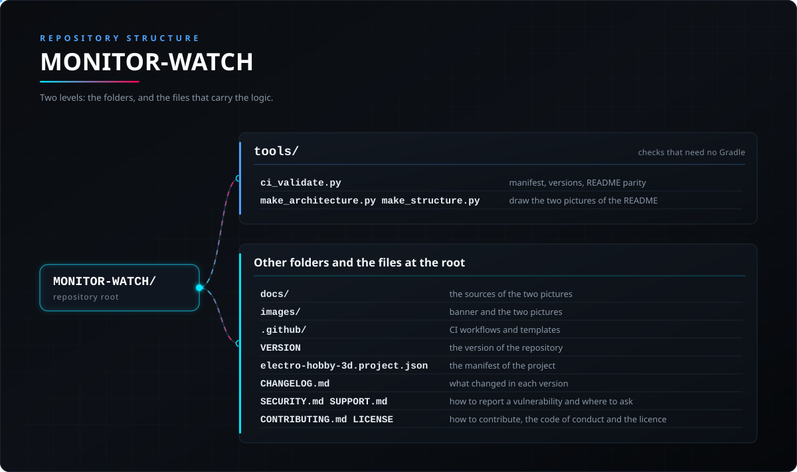

<p align="center">
  
</p>

# 🛠️ TOOLS-GITHUB-ACTIONS-MONITOR-WATCH

<p align="center"><a href="README.md">🇺🇸 English</a> | 🇪🇸 <b>Español</b> | <a href="README_fra.md">🇫🇷 Français</a> | <a href="README_ita.md">🇮🇹 Italiano</a> | <a href="README_deu.md">🇩🇪 Deutsch</a> | <a href="README_zho.md">🇨🇳 中文</a> | <a href="README_jpn.md">🇯🇵 日本語</a> | <a href="README_por.md">🇵🇹 Português</a></p>

### Versión mínima prevista para reloj con Wear OS de la app Android de GitHub Actions Monitor: un vistazo rápido a tus workflows en la muñeca. Solo andamiaje: todavía no hay nada implementado.

<p align="center">
  
  
  
  
  
  
</p>

---

**Comprobación de honestidad - lo que se ejecuta hoy:** nada de la app de reloj. Este repositorio solo contiene su base: los documentos, el manifiesto, la licencia y las comprobaciones compartidas del repositorio. No hay código, ni paquete, ni pantalla, ni servicio de notificaciones, ni pruebas de la app, y no se ha probado nada en un reloj.

---

## 📋 De un vistazo

| | |
|---|---|
| Versión | `0.0.1` |
| Madurez | Andamiaje |
| Pruebas | Ninguna todavía (solo las comprobaciones del repositorio) |
| Pila tecnológica | Kotlin y Wear OS (previsto) |
| En hardware real | No se ha ejecutado en un reloj |

**Ir a:** [Resumen](#-resumen) · [Arquitectura](#-arquitectura) · [Inicio rápido](#-inicio-rápido) · [Pruebas](#-pruebas) · [Estructura del repositorio](#-estructura-del-repositorio) · [Proyectos relacionados](#-proyectos-relacionados)

## 🚦 Estado del proyecto

Cada línea es una parte de este repositorio y la luz dice hasta dónde llega hoy. Se escribe con lo que el repositorio puede demostrar (pruebas, compilaciones, ejecuciones), no con lo previsto.

🟢 Hecho y verificado · 🟡 Funciona, con límites conocidos · 🟠 Hecho a medias o sin verificar · 🔴 Sin hacer o sin funcionar

| Área | Estado | Qué significa aquí |
|---|---|---|
| Base del repositorio | 🟡 | El manifiesto, los README en ocho idiomas, la licencia y las comprobaciones compartidas del repositorio se ejecutan en el CI. |
| Código de la app de reloj | 🔴 | Sin empezar: este repositorio aún no tiene ningún proyecto de reloj. |
| Pruebas | 🔴 | No hay pruebas de la app; solo se ejecutan las comprobaciones del repositorio. |
| Conexión con el monitor | 🔴 | Sin empezar. Aún no está decidido cómo obtendrá el reloj sus datos (a través de la app Android o directamente). |
| Reloj y notificaciones | 🔴 | Sin empezar y nunca ejecutada en un reloj; no hay ningún servicio de notificaciones conectado. |

## 🎯 Resumen

* **Qué será:** una versión mínima para reloj con Wear OS de la app Android, con un vistazo rápido a si hay algo en rojo y a las últimas alertas importantes de tu propio monitor.
* **Sigue a la app Android:** se construye después de [TOOLS-GITHUB-ACTIONS-MONITOR-ANDROID](https://github.com/JuanenRac/TOOLS-GITHUB-ACTIONS-MONITOR-ANDROID) y se limita a un subconjunto de lo que muestra esa app.
* **Solo lectura:** solo leerá de tu monitor. No escribirá en GitHub ni cambiará nada en el monitor.
* **Qué no es (todavía):** no hay app que instalar, ni release, ni fecha. Este repositorio solo reserva su sitio y cuenta con honestidad lo que está previsto.

## 🧩 Papel en EH3D

TOOLS-GITHUB-ACTIONS-MONITOR-WATCH pretende ser la versión mínima para reloj con Wear OS de la app Android [TOOLS-GITHUB-ACTIONS-MONITOR-ANDROID](https://github.com/JuanenRac/TOOLS-GITHUB-ACTIONS-MONITOR-ANDROID) de GitHub Actions Monitor ([TOOLS-GITHUB-ACTIONS-MONITOR](https://github.com/JuanenRac/TOOLS-GITHUB-ACTIONS-MONITOR)). Mostraría una pequeña parte de lo que el monitor ya sabe y no decidiría nada por su cuenta.

## 🏛️ Arquitectura

<p align="center">
  
</p>

Cómo encajan las partes de este repositorio: quién lo usa, qué contiene y de qué depende. La imagen se dibuja desde `docs/architecture.json` y se comprueba contra el código.

## ✨ Funciones

**Previsto, y nada de ello existe todavía:**
* Un vistazo: ¿hay algo en rojo?
* Las últimas alertas importantes de forma breve.
* Opcionalmente, una vibración ante una alerta importante, desactivada por defecto.
* Textos en ocho idiomas.

**No previsto:** escribir en GitHub, listas largas ni ninguna acción que no sea mirar. El reloj no hará falta para ejecutar el monitor.

## 🔒 Seguridad y protección

* Previsto: la app de reloj solo lee, y cualquier token de acceso se queda en tus dispositivos y se envía únicamente a la dirección de tu monitor (o a la app Android).
* Nada secreto tiene cabida en este repositorio: ni claves, ni tokens, ni archivos de servicios de notificaciones, ni claves de firma.
* Son intenciones de diseño. Nada de ello existe todavía, así que nadie ha podido revisarlo.

## 🚀 Inicio rápido

Todavía no hay nada que instalar ni ejecutar. Para comprobar la base de este repositorio necesitas Python 3.10 o posterior:

```bash
python -I tools/ci_validate.py
python -I tools/make_architecture.py --check
python -I tools/make_structure.py --check --readmes
python -I -m unittest discover -s tools -p "test_*.py"
```

## 🧪 Pruebas

El CI ejecuta las comprobaciones del repositorio y las pruebas de esas comprobaciones. La app de reloj no tiene pruebas propias porque aún no tiene código, y aquí no se afirma ningún contador de pruebas.

## 🏗️ Compilación y publicación

No hay compilación ni release, porque no existe ninguna versión de la app. La versión `0.0.1` de `VERSION`, del manifiesto y del registro de cambios es la de la base del repositorio.

## 📂 Estructura del repositorio

<p align="center">
  
</p>

<details>
<summary>Versión en texto del árbol</summary>

```text
MONITOR-WATCH/
├── tools/
│   ├── ci_validate.py                           manifiesto, versiones, paridad de README
│   └── make_architecture.py make_structure.py   dibujan las dos imágenes del README
├── docs/                                        las fuentes de las dos imágenes
├── images/                                      banner y las dos imágenes
├── .github/                                     flujos de CI y plantillas
├── VERSION                                      la versión del repositorio
├── electro-hobby-3d.project.json                el manifiesto del proyecto
├── CHANGELOG.md                                 qué cambió en cada versión
├── SECURITY.md SUPPORT.md                       cómo informar de una vulnerabilidad y dónde preguntar
└── CONTRIBUTING.md CODE_OF_CONDUCT.md LICENSE   cómo contribuir, el código de conducta y la licencia
```

</details>

## 🗺️ Hoja de ruta y límites conocidos

**Límites conocidos hoy**

* No hay código: ni app, ni paquete, ni pantalla.
* No se ha probado nada en un reloj ni con un monitor real.
* El reloj sigue a la app Android, así que no puede empezar antes de que esa app exista.
* Aún no está decidido cómo obtiene el reloj sus datos.

**Siguiente**

* Esperar a la app Android, decidir cómo obtiene el reloj sus datos y construir la pantalla útil más pequeña, con sus pruebas en el CI.

## 🌍 Idiomas

El README y los textos existen en inglés, español, francés, italiano, alemán, chino, japonés y portugués de Portugal.

## 🔗 Proyectos relacionados

* [TOOLS-GITHUB-ACTIONS-MONITOR](https://github.com/JuanenRac/TOOLS-GITHUB-ACTIONS-MONITOR): el monitor cuyos datos pretende mostrar el reloj con Wear OS
* [TOOLS-GITHUB-ACTIONS-MONITOR-ANDROID](https://github.com/JuanenRac/TOOLS-GITHUB-ACTIONS-MONITOR-ANDROID): la app Android prevista a la que sigue esta versión de reloj con Wear OS
* [EH3D-DOCS](https://github.com/JuanenRac/EH3D-DOCS): las convenciones y las comprobaciones compartidas

## 📚 Documentación

* [Las convenciones de la suite](https://github.com/JuanenRac/EH3D-DOCS/blob/main/docs/CONVENTIONS.md)
* [Registro de cambios](CHANGELOG.md)

## 🤝 Contribuir y comunidad

* Antes de una pull request ejecuta `python -I tools/ci_validate.py`; las demás comprobaciones se ejecutan en el CI. Consulta [CONTRIBUTING.md](CONTRIBUTING.md) y el [código de conducta](CODE_OF_CONDUCT.md).
* El README existe en ocho idiomas: un cambio en el texto se hace en los ocho archivos, y las dos imágenes se dibujan a partir de `docs/architecture.json` y `docs/structure.json` con `tools/make_architecture.py` y `tools/make_structure.py`.
* Informa de una vulnerabilidad en privado: [SECURITY.md](SECURITY.md). Preguntas, ideas e informes: electrohobby3d@gmail.com ([SUPPORT.md](SUPPORT.md)).

## 👤 AUTOR

**JuanenRac (Electro Hobby 3D)** · electrohobby3d@gmail.com

## 📜 LICENCIA

Software: GPL-3.0-or-later. Véase [LICENSE](LICENSE). Los diseños de hardware de la suite usan CERN OHL-S.
